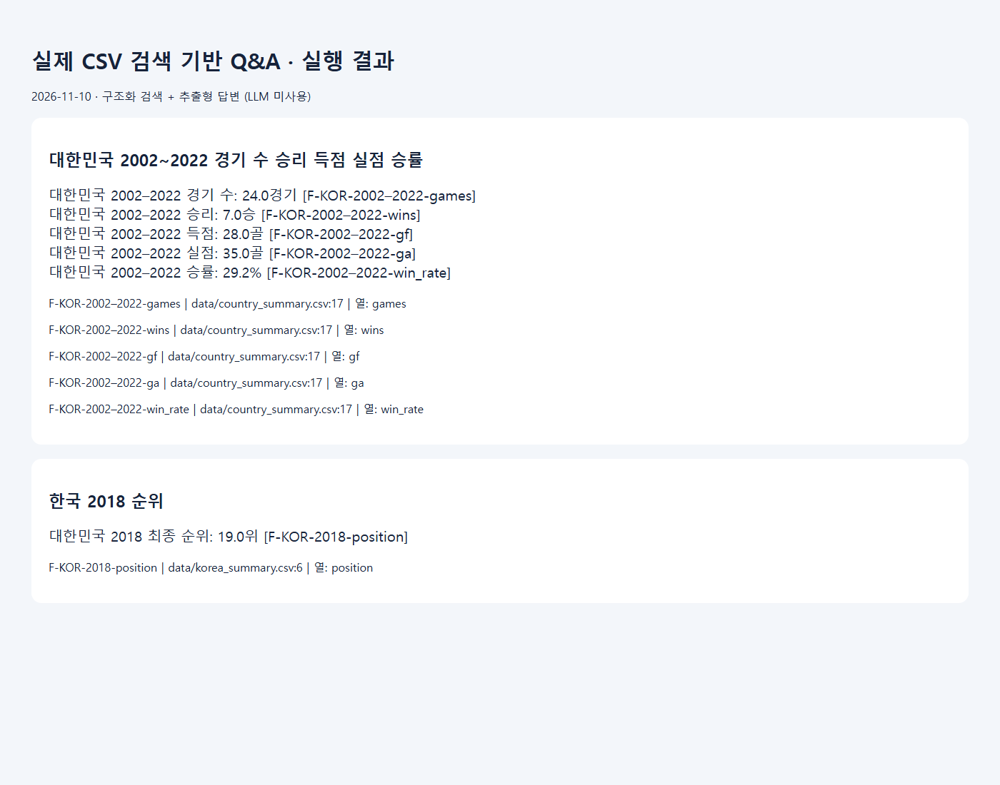
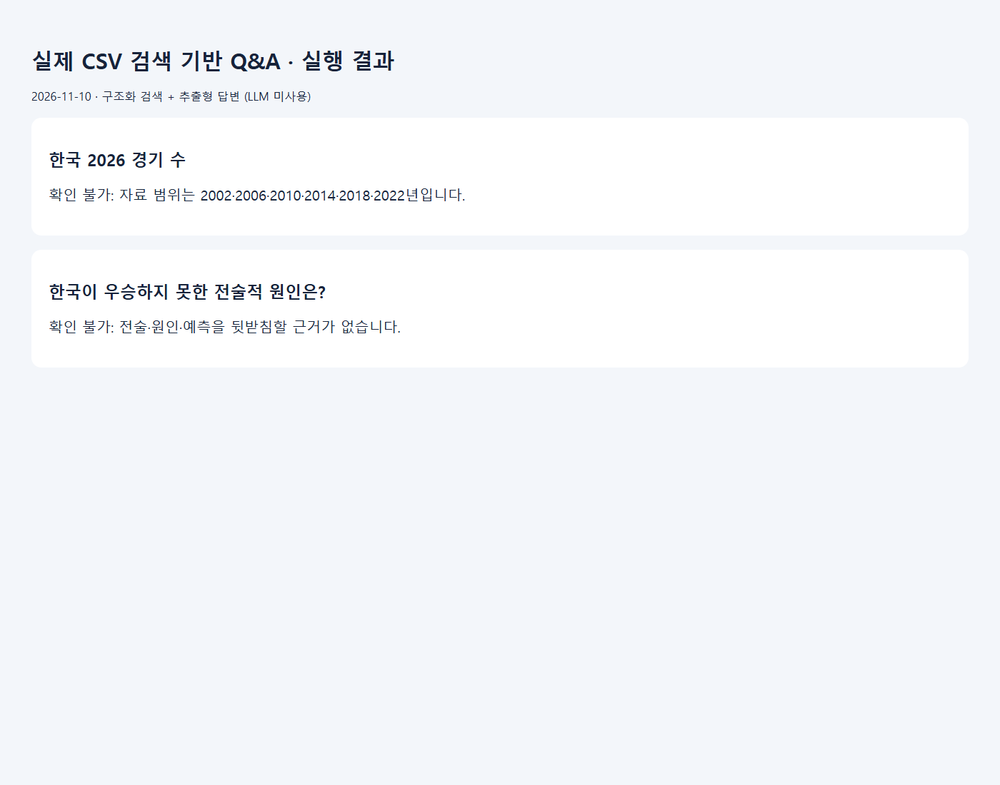

# WHY NOT KOREA? 월드컵 데이터 분석

FIFA 월드컵 경기 기록으로 대한민국과 주요 대표팀의 성적을 비교하고, 기사 속 수치를 원본 데이터까지 추적하는 데이터 저널리즘 프로젝트다.

2002·2006·2010·2014·2018·2022년 FIFA 남자 월드컵 본선 384경기를 분석했다. 출전한 62개 대표팀에서 누적 승리 수 상위 10개국을 선정하고 대한민국을 별도로 추가했다. 대한민국은 24경기 7승 6무 11패, 28득점 35실점으로 경기당 1.17득점·1.46실점, 승률 29.2%였다.

| 선정 순서 | 국가 | 경기 | 승 | 득점/경기 | 실점/경기 | 승률 |
|---:|---|---:|---:|---:|---:|---:|
| 1 | 독일 | 34 | 23 | 2.06 | 0.79 | 67.6% |
| 2 | 브라질 | 34 | 23 | 1.88 | 0.88 | 67.6% |
| 3 | 프랑스 | 32 | 18 | 1.56 | 0.84 | 56.2% |
| 4 | 아르헨티나 | 31 | 18 | 1.68 | 1.03 | 58.1% |
| 5 | 네덜란드 | 23 | 16 | 1.74 | 0.70 | 69.6% |
| 6 | 스페인 | 27 | 15 | 1.74 | 1.00 | 55.6% |
| 7 | 잉글랜드 | 29 | 12 | 1.45 | 0.90 | 41.4% |
| 8 | 벨기에 | 19 | 12 | 1.53 | 0.95 | 63.2% |
| 9 | 포르투갈 | 26 | 11 | 1.62 | 1.12 | 42.3% |
| 10 | 우루과이 | 22 | 10 | 1.27 | 1.09 | 45.5% |
| 별도 추가 | 대한민국 | 24 | 7 | 1.17 | 1.46 | 29.2% |

## 2026-11-11 실습 결과와 기사 검토

### Chrome에서 기사 비교 열기

**[http://localhost:8501](http://localhost:8501)**

Windows에서 Streamlit 서버를 실행한 PC의 Chrome에서 열 수 있는 주소다. 서버를 종료하면 접속할 수 없다. 선생님 PC에서 보려면 아래 절차로 그 PC에서 서버를 시작한다.

1. 프로젝트 전체를 내려받거나 복사한다. 기사 원본 2개, `reports/article_revision_2026-11-11/`, `charts/`, `data/`, `docs/`를 README와 함께 가져온다.
2. Windows에 Python 3.12를 준비하고 README가 있는 폴더에서 아래 PowerShell 명령으로 Streamlit을 한 번 설치한다. 의존성은 [requirements-streamlit.txt](requirements-streamlit.txt)에 있다. 처음 설치할 때는 인터넷 연결이 필요하다.

```powershell
python -m venv .venv
.\.venv\Scripts\python.exe -m pip install -r requirements-streamlit.txt
```

3. [start_worldcup_review.cmd](start_worldcup_review.cmd)를 더블클릭하거나 PowerShell에서 .\start_worldcup_review.cmd를 실행한다. 실행 파일이 같은 폴더의 [worldcup_review_app.py](worldcup_review_app.py)를 시작한다.
4. 서버 창을 켜 둔 채 Chrome에서 **[http://localhost:8501](http://localhost:8501)**을 연다. 왼쪽에서 기사 1 또는 2를 고른다. **기사 읽기**에서 기존 기사·수정본을 전환하고 선택한 버전을 Markdown으로 다운로드할 수 있다. **수정 전후 비교**에서는 두 버전을 나란히 읽고 바뀐 문장을 확인한다. **분석 그래프 8개**, **팩트체크**, **보고서 · 출처** 탭에서 한글 그래프, 판정과 근거를 볼 수 있다. 앱은 프로젝트 자료를 읽기 전용으로 열며, 검토를 마치면 서버 창에서 Ctrl+C로 종료한다. 이 주소는 외부 공개 URL이 아니다.

### 데이터와 기사 팩트체크

- [경기 원본 CSV](data/matches.csv)에서 2002~2022년 남자 월드컵 본선 6개 대회를 추려 **384경기, 팀·대회 기록 192건, 대표팀 62개국**을 확인했다. 팀·대회 기록은 같은 대표팀이라도 출전한 대회마다 한 건씩 센다. 한글 그래프 8개는 아래 **그래프 8개** 절에서 확인할 수 있다.
- 검색 증강 생성(RAG) 실습에서는 질문에 맞는 CSV 행을 찾아 근거 ID와 경로·행·열·SHA-256을 제시한다. 현재 대한민국 기록을 조회하며, 범위 밖 질문은 **확인 불가**로 응답한다. 아르헨티나 기록과 최종 성적 단계별 수치는 기사 팩트체크에서 CSV로 직접 재계산했다. [RAG 구현 및 한계](docs/RAG_IMPLEMENTATION.md)
- 기사 원본 2개와 원본 CSV를 보존하고, 기사 수정본은 별도 폴더에 저장했다. 기사 네 파일은 Windows 줄바꿈을 정규화한 뒤 검증 기록의 SHA-256과 모두 일치했다. [CSV 출처와 해시](data/provenance.json) · [기사 해시와 계산 근거](reports/article_revision_2026-11-11/verification.json)

| 검증 대상 | PASS | FAIL | HOLD | REVIEW | 합계 |
|---|---:|---:|---:|---:|---:|
| 최초 기사 원본 2개 | 32 | 4 | 4 | 1 | 41 |
| 기사 1 수정본 | 14 | 0 | 0 | 0 | 14 |
| 기사 2 수정본 | 23 | 0 | 0 | 0 | 23 |
| 수정본 합계 | **37** | **0** | **0** | **0** | **37** |

PASS는 자료와 일치, FAIL은 불일치, HOLD는 근거 부족으로 보류, REVIEW는 표현 검토가 필요한 항목이다. **37건 PASS는 수정본에 남은 검증 대상의 결과**다.

| 기사 | 원본 | 수정본과 주요 변경 |
|---|---|---|
| 1. 대한민국의 월드컵 기록 | [원본](article.md) | [수정본](reports/article_revision_2026-11-11/article.revised.md) · 본문은 유지하고 저장 위치에 맞춰 README 상대 링크를 수정했다. |
| 2. 국가별 득점과 실점 비교 | [원본](WHY_NOT_KOREA_Final_Article.md) | [수정본](reports/article_revision_2026-11-11/WHY_NOT_KOREA_Final_Article.revised.md) · 아르헨티나 20승·64.5%를 18승·58.1%로 수정했다. 16강 48건과 8강 24건을 각각 해당 단계 **탈락** 기록으로 명시하고, 제목을 기록으로 확인할 수 있는 국가 간 비교로 바꿨다. |

원문의 전체 192개 팀·대회 기록에 대한 순위 상관관계 두 주장은 대회별 전체 순위가 없어 본문에서 제외했다. 기존 Kaggle 자료의 URL·버전과 FIFA 공식 자료를 직접 대조했는지는 확인할 수 없었다. 수정본에는 재검증에 실제로 사용한 Fjelstul CSV를 표시했다. 분석 기간은 2002~2022년이고 상대 전력과 전술은 반영하지 않았다. 이 자료로 우승 실패의 원인이나 우승 가능성을 추정하기 어렵다.

[최초 판정](reports/article_factcheck.md) · [수정본 팩트체크 보고서](reports/article_revision_2026-11-11/factcheck_report.md) · [문장별 수정 전후 비교](reports/article_revision_2026-11-11/sentence_comparison.md) · [근거 JSON](reports/article_revision_2026-11-11/verification.json) · [자동 테스트 로그](reports/article_revision_2026-11-11/test_results.txt)

### 검증 재현과 작업 기록

- 프로젝트 폴더에서 아래 명령을 실행한다. **RAG 5/5, 기사 팩트체크 4/4**로 총 9개 테스트가 통과했다. CSV 집계와 그래프를 다시 생성하는 절차는 아래 **VS Code에서 재현**에 있다.

```powershell
python -B -m unittest discover -s scripts -p 'test_*.py' -v
```

- README·그래프 PNG·의존성 파일의 Git 충돌을 해결하고 병합 커밋 511c2e1을 완료했다.
- 분석 코드에서 기존 집계표를 실제 위치인 data/에서 읽도록 경로를 수정했다.
- 원본 CSV를 보존하고 줄바꿈을 정규화해 출처 해시를 확인했다. 보조 스코어 CSV는 저장된 해시가 Windows 줄바꿈을 포함하므로 체크아웃 시 해당 형식을 유지한다. 대한민국 순위 CSV의 이전 해시와 차이가 생긴 정확한 원인은 확인되지 않았다. [출처와 해시 기록](data/provenance.json)
- 기사 해시 비교 시 Windows 줄바꿈을 정규화해 동일한 기사 버전을 인식하도록 수정했다. 기사 원문과 수정본을 함께 보존하고 Streamlit에서 변경 문장과 근거를 확인할 수 있게 했다.

## 데이터와 집계 기준

- **주 자료**는 Joshua C. Fjelstul의 [Fjelstul World Cup Database](https://github.com/jfjelstul/worldcup)다. 원본 CSV 3개를 `data/`에 담았다. 대회 ID로 남자 본선 6개 대회만 선택했다. 우승국은 대회 목록의 우승국 필드와 상위 4팀 순위표의 1위를 대조했다. 원본 및 이 프로젝트의 파생 데이터에는 [CC BY-SA 4.0](https://creativecommons.org/licenses/by-sa/4.0/)이 적용된다.
- **스코어 교차 검증**에는 [martj42 국제 경기 결과](https://github.com/martj42/international_results)의 월드컵 경기 384건을 사용했다. `independent_scores.csv`는 날짜·팀·스코어만 남긴 발췌본이다. 2006년 대회에서만 보조 자료의 세르비아 명칭을 세르비아 몬테네그로로 맞췄다. 홈·원정 표기 순서와 관계없이 날짜·양 팀·각 팀 점수를 비교해 384건이 일치했다. 두 데이터베이스의 기초 자료가 일부 겹칠 수 있다.
- **득점·실점과 승무패**는 정규시간과 연장전을 포함한 종료 스코어로 계산한다. 동점은 무승부로 기록한다. 승부차기 성공 횟수는 득실에 합산하지 않고, 승부차기 승리 횟수는 `shootout_wins`로 별도 보관한다. 예를 들어 2002년 스페인전은 0–0 무승부로 집계하며 대한민국의 승부차기 승리는 별도 열에 남는다.
- **국가 비교**는 원본 대표팀 코드로 묶고, 누적 승리 수 내림차순으로 정렬한다. 승수가 같으면 누적 득실차, 누적 득점, 대표팀 코드 오름차순 순으로 정한다. 대한민국은 이 정렬에서 16번째다. 경기당 득실은 기간 합계를 전체 경기 수로 나누고, 승률은 승리 ÷ 경기 × 100으로 구한다.
- **최종 순위**는 해당 대회 내 최종 성적 순서다. 2002년 4위는 Fjelstul의 순위표에서 확인했다. 2006·2010·2014·2022년은 아래 대회별 순위 자료를, 2018년은 연합뉴스 보도를 이용했다. `korea_positions.csv`에 순위를 별도로 저장했다. 5위 이하 순위는 해당 순위표의 분류를 따르므로, 16강 진출 여부와 세부 순위를 구분해 읽어야 한다. [2006년 최종 순위](https://en.wikipedia.org/wiki/2006_FIFA_World_Cup#Final_standings) · [2010년 최종 순위](https://en.wikipedia.org/wiki/2010_FIFA_World_Cup#Final_standings) · [2014년 최종 순위](https://en.wikipedia.org/wiki/2014_FIFA_World_Cup#Final_standings) · [2018년 연합뉴스](https://www.yna.co.kr/view/AKR20180629061000007) · [2022년 대회 순위](https://en.wikipedia.org/wiki/2022_FIFA_World_Cup#Tournament_ranking)

### 전처리와 기존 프로젝트 대조

기존 노트북은 연도별 국가 집계 CSV를 읽는 구조였고, 기존 보완 스크립트도 같은 입력을 요구했다. 첨부 ZIP에는 그 연도별 원본이 없었으며, 노트북 출력에서 복구한 4개국 표와 대한민국·우승국·단계별 요약표가 있었다. 이번 버전은 경기 원본을 양 팀 관점의 두 행으로 펼친 다음 팀·대회 단위와 국가 단위로 각각 합산한다. 대회당 64경기·32팀, 단계별 경기 수, 경기 키의 중복, 득실·승패의 대칭, 승부차기 경기의 종료 스코어, 대한민국 경기 수 및 집계를 검사한다. 대회별 총득점 161·147·145·171·169·172골은 FIFA 자료와 일치한다. [FIFA 대회별 득점 집계](https://www.fifa.com/de/articles/wm-katar-2022-torrekord)

- 기존 4개국의 경기 수·득점·실점은 모두 일치했다. 독일·브라질·대한민국의 승수도 일치했다. 아르헨티나의 기존 20승은 종료 스코어 기준 18승과 다르다. 승부차기 승리 3건을 모두 포함하면 21승이므로 기존 수치가 어떤 규칙에서 나왔는지는 원본 없이 확인할 수 없다. `data/legacy_comparison.csv`에서 두 기준을 확인할 수 있다.
- 대한민국의 6개 대회별 경기·승무패·득실은 기존 표와 일치했다. 2018년 최종 순위는 25위에서 19위로 수정했다. [2018년 연합뉴스](https://www.yna.co.kr/view/AKR20180629061000007)
- 우승팀 경기당 득실과 단계별 표본 수·득실차는 기존 표와 표시 정밀도 내에서 일치했다. 기존의 8강·16강 ‘진출’ 표기는 집단이 겹쳐 보일 수 있어 ‘탈락’으로 구분했다.

## 그래프 8개

### 1. 대한민국 대회별 최종 순위


- **목적과 축** 6개 대회의 성적 변화를 본다. 가로축은 연도, 세로축은 해당 대회 최종 순위이며 위로 갈수록 좋은 성적이다.
- **결과** 4→17→15→27→19→16위였다. 2002년이 분석 기간 최고 성적이다.
- **한계** 순위 간격은 경기력 차이의 크기를 뜻하지 않는다.

### 2. 상위 10개국과 대한민국의 득점·실점


- **목적과 축** 세로축에 국가를, 가로축에 경기당 득점과 실점(골)을 표시한다.
- **결과** 대한민국은 11개 비교팀 중 경기당 득점이 가장 적고 실점이 가장 많았다. 독일은 경기당 2.06골을 넣었고, 네덜란드는 경기당 0.70골을 내줬다.
- **한계** 상대 전력, 대회별 출전 횟수, 개최지와 경기 단계를 보정하지 않았다.

### 3. 2002년 대한민국과 우승국 평균


- **목적과 축** 가로축은 득점과 실점 항목, 세로축은 경기당 골 수다. 우승팀 6개 기록을 같은 비중으로 평균했다. 팀당 7경기이므로 42경기를 합산해 계산한 값과 같다.
- **결과** 2002년 대한민국은 1.14득점·0.86실점, 우승팀 평균은 2.02득점·0.62실점이었다.
- **한계** 한 팀의 단일 대회와 6개 우승팀의 평균을 비교한다. 우승팀 평균을 우승에 필요한 기준선으로 해석할 수 없다.

### 4. 최종 성적 그룹별 경기당 득실차


- **목적과 축** 가로축은 최종 도달 단계, 세로축은 경기당 득실차(골)다. 팀별 대회 전체의 경기당 득실차를 먼저 구한 뒤 그룹 안에서 같은 비중으로 평균했다. 빨간 점은 대한민국의 해당 대회 기록이다.
- **결과** 4강 진출 +0.91, 8강 탈락 +0.83, 16강 탈락 −0.02, 조별리그 탈락 −0.87골이었다. 2002년 대한민국은 +0.29골이었다.
- **한계** 같은 팀이 여러 대회에 포함될 수 있고, 그룹별 경기 수와 상대가 다르다. 높은 득실차가 진출을 보장한다는 의미는 없다.

### 5. 상위 10개국과 대한민국의 승률


- **목적과 축** 세로축은 국가, 가로축은 승률(%)이다. 막대 끝에 승리 수와 경기 수도 표시했다.
- **결과** 누적 승수는 독일과 브라질이 23승으로 가장 많았고, 표시된 팀 중 승률은 네덜란드가 69.6%로 가장 높았다. 대한민국은 29.2%였다.
- **한계** 승수로 미리 선별한 집단이라 전체 62개국의 승률 순위로 해석할 수 없다.

### 6. 상위 10개국과 대한민국의 공격·수비


- **목적과 축** 가로축은 경기당 득점, 세로축은 경기당 실점이다. 각 점 번호를 오른쪽의 국가명과 득점·실점 수치에 연결했다.
- **결과** 대한민국은 비교팀의 왼쪽 위에 위치했다. 오른쪽 아래일수록 득점이 많고 실점이 적다.
- **한계** 골 수에 근거한 비교다. 슈팅의 질, 수비 전술, 상대의 수준은 측정하지 않았다.

### 7. 대한민국 대회별 상관관계


- **목적과 축** 양축은 최종 순위, 승률, 경기당 득점과 실점이다. 색과 숫자는 피어슨 상관계수(−1~+1, 무단위)다. 색은 상관관계의 부호와 크기를 표현하며, 빨간 범례로 대한민국 표본을 표시했다.
- **결과** 최종 순위 숫자와 승률의 상관은 −0.85, 경기당 실점과의 상관은 +0.55, 경기당 득점과의 상관은 −0.34였다.
- **한계** 관측값은 대회 6개다. 순위는 순서형 자료이고 승률·순위는 같은 경기 결과의 영향을 받으므로 상관계수를 인과적 효과로 해석할 수 없다.

### 8. 대한민국 대회별 득점·실점 분포


- **목적과 축** 가로축은 득점·실점, 세로축은 대회별 경기당 평균(골)이다. 각 빨간 점이 한 대회이며, 상자는 1~3사분위 범위, 상자 내부 선은 중앙값이다.
- **결과** 대회별 경기당 득점의 중앙값은 1.07골, 실점은 1.67골이다.
- **한계** 경기 수가 다른 6개 대회에 같은 비중을 준 중앙값이다. 전체 24경기의 평균이나 개별 경기 분포와는 다르다.

## Python 분석과 AI 기사 작성

| 도구 | 역할 |
|---|---|
| Python 표준 라이브러리 | 로컬 경로와 환경 변수 처리 |
| pandas | 원본 CSV 읽기, 팀별 변환, 검증, 집계표 출력 |
| NumPy | 그래프 좌표와 수치 비교 |
| Matplotlib | 한글 그래프 8개를 300 dpi PNG로 생성 |
| ipykernel · IPython | VS Code에서 노트북 실행 및 결과 표시 |

Python이 먼저 수치와 그래프를 재현한다. 기사 작성에는 검증을 통과한 요약표와 데이터 정의를 근거로 제공한다. 프롬프트에 기간·단위·비교 집단·승부차기 규칙을 적고, 주어진 표에서 확인할 수 있는 주장만 초안에 포함하도록 요청한다. 편집자는 숫자를 CSV에 대조하고 기사 제목이 인과관계를 암시하는지 확인한다. 업데이트한 기사 초안은 [article.md](article.md)에 있다. 기존 노트북에는 OpenAI API 호출 단계가 있었으며, 이번 분석의 재현에는 API 키가 필요 없다.

**검색 증강 생성(Retrieval-Augmented Generation, RAG)의 구조화 근거 검색과 추출형 답변을 구현했다.** 질문의 대상·연도·항목으로 실제 CSV 행을 검색한 뒤 검색 결과에서만 답변을 구성한다. 외부 LLM 생성 단계는 사용하지 않으며 자유로운 일반 질문을 처리하는 챗봇은 아니다. [RAG 설계](docs/RAG_DESIGN.md)와 [구현 및 한계](docs/RAG_IMPLEMENTATION.md)를 참고한다.

### 근거 기반 질문·답변 실행

```powershell
python scripts/rag_qa.py "대한민국 2002~2022 경기 수 승리 득점 실점 승률"
python scripts/rag_qa.py "한국 2026 경기 수"
python -B -m unittest discover -s scripts -p test_rag_qa.py -v
```

대한민국의 경기 수·승리·득점·실점·승률과 대회별 순위를 지원한다. 연도를 생략하면 2002–2022 전체 기록을 조회한다. 각 답변에는 근거 ID, CSV 경로·행·열 및 SHA-256이 포함된다. 2026년이나 전술적 원인 등 근거가 없는 질문에는 **확인 불가**를 반환한다.

실행 JSON을 HTML로 표시한 실제 브라우저 스크린샷이다. 실시간 채팅 UI 화면은 아니다.





[실행 원본 JSON](docs/rag_evidence/results.json) · [테스트 결과](docs/rag_evidence/test_results.txt)


## VS Code에서 재현

1. ZIP을 풀고 README가 있는 폴더를 VS Code로 연다. Python 3.12와 VS Code의 Python·Jupyter 확장을 준비한다.
2. PowerShell 터미널에서 실행한다.

```powershell
python -m venv .venv
.\.venv\Scripts\python.exe -m pip install -r requirements.txt
.\.venv\Scripts\python.exe analyze.py
```

3. `worldcup_analysis.ipynb`를 열고 `.venv`의 Python 커널을 선택한 뒤 **Run All**을 실행한다. `data/`에 결과 CSV, `charts/`에 그래프가 생성된다. 분석 실행 중 인터넷 연결은 필요 없다.
4. Windows에서는 맑은 고딕을 자동 사용한다. 다른 환경에서는 Noto Sans CJK KR, 나눔고딕, AppleGothic 중 하나를 설치하거나 `KOREAN_FONT`에 글꼴 파일 경로를 지정한다.

이전 분석 노트북 [WHY_NOT_KOREA_WorldCup_Analysis.ipynb](WHY_NOT_KOREA_WorldCup_Analysis.ipynb)와 비교용 집계표는 검증 근거로 보관했다. 제출용 그래프는 charts/에 있으며, 기존 그림과 수업 실습 파일은 원본 ZIP에 있다.

실행 결과는 [test_results.txt](test_results.txt), 원본 출처와 파일 해시는 [data/provenance.json](data/provenance.json)에서 확인할 수 있다.


## Git 저장소 구조 정리 (2026-11-11)

프로젝트 작업 중 동일한 이름의 폴더와 Git 저장소가 중첩되어 작업 경로가 혼동되는 문제가 발생했다.

두 저장소의 파일과 Git 기록을 비교하고, 각각 백업 및 복원 검증을 완료한 후 GitHub 최신 버전을 기준으로 단일 저장소로 통합했다.

### 최종 프로젝트 경로 (Windows)

`C:\WORKSPACE\WHY_NOT_KOREA_WorldCup_Analysis`

### 검증 결과

- 최종 프로젝트 폴더에 `.git`이 하나만 있는 것을 확인했다.
- 기존 README, 원본 데이터, 그래프 8개, RAG, 기사 및 Streamlit 앱을 보존했다.
- 로컬 `main`과 GitHub `origin/main`의 Commit 일치를 확인했다.
- Git 작업 트리에 미커밋 변경이나 미해결 충돌이 없었다.
- 기존 검토용 Python 환경에서 Streamlit 서버를 실행해 HTTP 200 응답을 확인했다.
- 두 저장소의 백업 및 파일 무결성 검증을 완료했다.

### 프로젝트 실행 안내

VS Code에서 `C:\WORKSPACE\WHY_NOT_KOREA_WorldCup_Analysis` 폴더를 직접 연다.

Streamlit은 README의 설치 절차에 따라 환경을 준비한 후 `start_worldcup_review.cmd`로 실행한다.

접속 주소: http://localhost:8501

이 주소는 Streamlit 서버를 실행한 컴퓨터에서만 사용할 수 있다.


