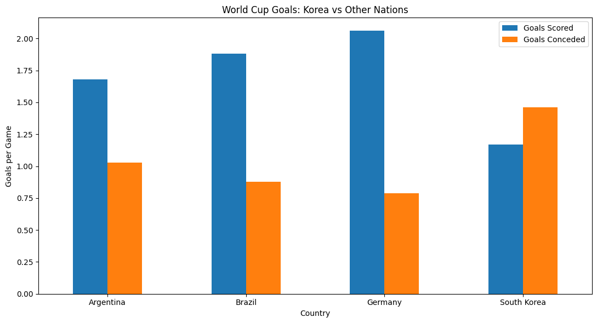

# ⚽ WHY NOT KOREA? — 월드컵 데이터 저널리즘 실습

2002~2022년 남자 월드컵 6개 대회를 중심으로 한국의 성적과 비교 대상의 득점·실점 기록을 살펴봅니다. 한국의 순위 추이만 1954~2022년 참가 대회를 다룹니다.

- [원본 분석 노트북](WHY_NOT_KOREA_WorldCup_Analysis.ipynb)
- [기존 최종 기사](WHY_NOT_KOREA_Final_Article.md)
- [데이터와 검증 범위](docs/DATA_AND_FACTCHECK.md)

## 기존 그래프 5개

①~⑤ PNG는 기존 노트북의 저장 이미지와 바이트 단위로 일치합니다. 그래프를 만드는 코드와 저장된 표를 대조했습니다. 아래 셀 번호는 노트북 맨 위부터 세는 1-based 번호입니다.

### ① 한국의 대회별 최종 순위 · 선그래프


1954~2022년 한국이 참가한 11개 대회에서 최종 순위가 어떻게 달라졌는지 보여줍니다. 순위 축을 뒤집어 숫자가 작은 순위가 위에 표시됩니다. 저장된 참가 기록에서 최고 성적은 2002년 4위입니다. 표는 셀 6, 그래프는 셀 7에 있습니다.

### ② 네 나라의 경기당 득점·실점 · 묶은 막대그래프


2002~2022년 아르헨티나, 브라질, 독일, 한국을 비교합니다. 국가별 총득점과 총실점을 각각 전체 경기 수로 나눴습니다. 저장된 합계에서 한국은 24경기 28득점·35실점으로 경기당 1.17득점·1.46실점입니다. 네 나라 중 득점은 가장 낮고 실점은 가장 높습니다. 표는 셀 9, 그래프는 셀 10에 있습니다.

### ③ 2002년 한국과 우승팀 평균 · 묶은 막대그래프


2002년 한국의 경기당 1.14득점·0.86실점을 2002~2022년 우승팀 6개 기록의 평균인 2.02득점·0.62실점과 비교합니다. 우승팀은 대회별 경기당 값을 먼저 구한 뒤 동일한 비중으로 평균했습니다. 우승팀별 표는 셀 11, 비교 표와 그래프는 셀 12에 있습니다.

### ④ 최종 순위 구간별 경기당 득실차 · 막대그래프


팀별 대회 기록 192건을 최종 순위 1~4위, 5~8위, 9~16위, 17~32위로 나눕니다. 그림의 막대는 **평균 경기당 득점에서 평균 경기당 실점을 뺀 값**입니다. 저장된 결과는 순서대로 +0.91, +0.83, −0.02, −0.87골입니다. 반올림은 차이를 계산한 뒤 적용했습니다. 구간별 표는 셀 13, 득실차 표와 그래프는 셀 16에 있습니다.

### ⑤ 기사에 사용한 네 나라 비교 · 묶은 막대그래프



②와 동일한 네 나라, 기간, 지표를 기사에 삽입할 수 있도록 별도 제목과 그림으로 저장했습니다. 두 그림은 같은 집계 결과를 보여줍니다. 생성 코드는 셀 25, 기사 안에 표시하는 코드는 셀 26에 있습니다.

## Python으로 새로 만든 그래프 3개

### ⑥ 네 나라의 득점과 실점 · 산점도 (Scatter Plot)


점 하나가 국가 하나입니다. 셀 9에 저장된 정수 합계에서 경기당 득점과 실점을 다시 계산했습니다. 가로축에서 오른쪽일수록 득점이 많고, 세로축에서 위쪽일수록 실점이 많습니다. 한국은 네 나라 가운데 왼쪽 위에 위치합니다.

### ⑦ 한국의 대회별 지표 관계 · 상관관계 히트맵 (Correlation Heatmap)


셀 6의 한국 대회별 기록 6건에서 최종 순위, 승률, 경기당 득점·실점 사이의 피어슨 상관계수 (Pearson Correlation Coefficient)를 계산했습니다. 예를 들어 승률과 최종 순위 숫자의 상관계수는 약 −0.70입니다. 순위 숫자가 작을수록 성적이 좋으므로, 이 표본에서는 승률이 높은 대회에서 순위가 더 좋은 경향이 있었습니다. 표본이 작으며, 셀 14의 전체 192건 상관분석과는 모집 범위가 다릅니다. 전체 팀의 승률을 포함한 상관행렬을 다시 계산하려면 원본 행이 필요합니다.

### ⑧ 한국의 대회별 득점·실점 분포 · 박스플롯 (Box Plot)


2002~2022년 한국의 6개 대회에서 경기당 득점과 실점의 분포를 나란히 보여줍니다. 빨간 선은 중앙값, 상자는 가운데 50%, 파란 점은 각 대회의 실제 값입니다. 경기당 득점 중앙값은 1.07골, 실점 중앙값은 1.67골입니다. 우승팀·4강팀·조별리그 탈락팀 간 분포 비교에는 각 그룹의 개별 팀 기록이 필요합니다. 저장된 그룹 평균만으로는 사분위수와 이상치를 계산할 수 없어 한국의 대회별 기록으로 범위를 바꿨습니다.

## 재현 방법과 검증 범위

프로젝트 폴더에서 실행하면 노트북에 저장된 표를 읽어 ⑥~⑧을 다시 생성합니다. 원본 CSV와 API 키 없이 실행할 수 있습니다.

```sh
python -m pip install -r requirements.txt
python scripts/build_additional_charts.py
```

스크립트는 한국의 대회별 경기 수가 승·무·패의 합과 일치하는지 확인하고, 6개 대회 합계를 노트북의 국가별 집계와 대조합니다. ①~⑤는 기존 저장 출력이며 새로 그리지 않았습니다. 원본 노트북의 9개 검사는 저장된 계산값을 기대값과 대조한 내부 검사입니다.

노트북의 출처 표기는 Kaggle FIFA World Cup Dataset이며, 정확한 데이터셋 주소와 버전은 기록되어 있지 않습니다. 연도별 원본 CSV가 없어 원본 데이터부터 전체 분석을 재실행하거나 FIFA 공식 기록과 독립적으로 대조하지 못했습니다. 원본이 확보되면 [데이터 안내](data/README.md)와 기존 [CSV 구조 검사](scripts/validate_worldcup.py)를 참고할 수 있습니다. 저장된 통계는 대회 성적과 득실의 관계를 보여주며 우승 실패의 원인을 확정할 수 없습니다.

## 사용한 라이브러리와 구현 범위

- **Python 분석** · 원본 노트북은 **pandas**로 연도별 표를 결합하고 팀 이름을 통일한 뒤, 국가별 집계·경기당 지표·승률·상관계수를 계산했습니다. **Matplotlib**으로 그래프를 그렸습니다. 이번 버전은 같은 라이브러리로 저장된 표를 다시 계산해 산점도·히트맵·박스플롯을 추가했습니다.
- **실제 구현한 기사 작업** · 원본 노트북은 **OpenAI Python SDK**로 계산 결과를 정리한 사실표 (Fact Sheet)를 프롬프트에 직접 넣어 초안 작성, 사실표 대조, 수정, 교열을 진행했습니다.
- **검색 증강 생성 (Retrieval-Augmented Generation, RAG)** · [RAG 설계 문서](docs/RAG_DESIGN.md)에 자료 인덱싱, 질문별 근거 검색, 인용 연결을 제안했습니다. 이 기능들은 설계 단계입니다.
