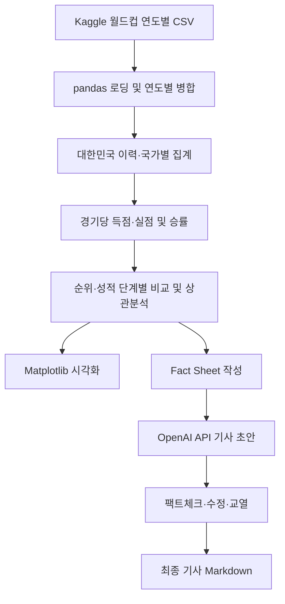

# ⚽ WHY NOT KOREA? — World Cup Data Analysis

**대한민국은 왜 월드컵에서 우승하지 못했을까?**  
2002~2022년 FIFA 월드컵의 국가별 대회 집계 자료를 Python으로 분석하고, 수치 검증을 거쳐 데이터 기반 기사 초안을 작성한 **MBC AI 데이터 저널리즘 실습 프로젝트**입니다.

**실습일:** 2026-10-29 · **작성:** Dominic Kim (김형석)  
**도구:** Google Colab · Python · pandas · Matplotlib · OpenAI API (기사 초안 및 검수 과정)

> **분석 범위 주의:** 공개된 수치는 제공된 노트북의 저장된 분석 결과와 최종 기사에서 옮긴 것입니다. 이 저장소 작성 과정에서 원본 CSV로 전체 코드를 새로 실행하거나 FIFA 공식 기록과 독립 대조한 것은 아닙니다. 국가별 대회 집계 자료에서 관찰한 상관관계는 우승 실패의 원인을 입증하지 않습니다.

## 1. 핵심 분석 결과

| 지표 | 대한민국 (2002~2022) | 비교 기준 / 의미 |
|---|---:|---|
| 경기 수 | 24경기 | 2002~2022년 6개 대회 |
| 승리 | 7승 | 데이터셋의 Win 기준 |
| 승률 | 29.2% | 7 ÷ 24 |
| 총득점 / 총실점 | 28골 / 35골 | 국가별 대회 집계의 합계 |
| 경기당 득점 | 1.17골 | 28 ÷ 24 |
| 경기당 실점 | 1.46골 | 35 ÷ 24 |
| 최고 성적 | 2002년 4위 | 분석 대상 기간 기준 |

비교 대상 국가의 경기당 득점은 **아르헨티나 1.68 · 브라질 1.88 · 독일 2.06**, 실점은 **아르헨티나 1.03 · 브라질 0.88 · 독일 0.79**로 최종 기사에 기록되어 있습니다. 표본 경기 수가 서로 다르므로 경기당 지표를 사용했습니다.

**상관분석:** 최종 순위 숫자(`Position`, 숫자가 작을수록 좋은 성적)와 경기당 득점의 상관계수 **−0.678**, 경기당 실점의 상관계수 **+0.637**이 노트북에 기록되어 있습니다. 이것은 관찰된 관계이지 인과관계 증명이 아닙니다.

## 2. 주요 그래프

### 대한민국의 월드컵 순위 변화


**질문:** 2002~2022년 대한민국의 월드컵 순위는 어떻게 달라졌는가?  
**읽은 결과:** 2002년 4위가 분석 기간의 최고 성적이며, 다른 대회에서는 같은 성적을 재현하지 못했습니다.

### 한국과 비교 대상 국가의 득점·실점


**질문:** 대한민국의 경기당 득점과 실점은 아르헨티나·브라질·독일과 어떻게 다른가?  
**읽은 결과:** 대한민국은 이 비교 집단에서 경기당 득점이 낮고 실점이 높은 것으로 집계되었습니다.

### 2002년 대한민국과 우승국 평균 비교


**질문:** 2002년 대한민국의 공격·수비 지표는 우승국 집단의 평균과 어떻게 달랐는가?  
**읽은 결과:** 경기당 득점과 실점의 차이는 관찰할 수 있지만, 이 차이만으로 우승 실패의 원인을 확정할 수 없습니다.

### 최종 성적 단계별 득실 차이


**질문:** 최종 성적 단계별로 경기당 평균 득점에서 실점을 뺀 값은 어떻게 다른가?  
**읽은 결과:** 4강 진출팀 집단은 조별리그 탈락팀 집단과 다른 득실 패턴을 보이지만, 이는 기술통계 결과입니다.

### 최종 국가 비교 차트


위 PNG 파일은 **원본 Colab 노트북의 저장된 차트 출력**에서 추출했습니다. 현재 데이터를 재실행한 결과가 아니며, 코드와 출력이 일치하는지는 원본 CSV로 재현할 때 다시 점검해야 합니다.

## 3. 분석 과정



주요 처리 단계는 다음과 같습니다.

1. `Team`, `Position`, `Games Played`, `Win`, `Draw`, `Loss`, `Goals For`, `Goals Against` 등 원자료 필드를 확인합니다.
2. 파일명에서 대회 연도를 추출하고 2002~2022년 기록을 결합합니다.
3. `South Korea` / `Korea Republic` 명칭을 정리하고 비교할 국가를 선택합니다.
4. 국가별 경기 수·승수·득실점 합계를 구한 뒤 경기당 지표와 승률을 계산합니다.
5. 순위를 기준으로 조별리그·16강·8강·4강을 구분하여 평균과 상관계수를 분석합니다.
6. 확인된 값을 Fact Sheet로 만들고 AI 기사 작성 → 팩트체크 요청 → 수정 → 교열을 진행합니다.

## 4. 저장소 파일

```text
WHY_NOT_KOREA_WorldCup_Analysis.ipynb   # 원본 Colab 분석·AI 기사 생성 노트북
WHY_NOT_KOREA_Final_Article.md         # 원본 최종 기사
charts/                                # 저장된 노트북 출력에서 추출한 PNG 5개
README.md                              # 프로젝트 소개와 재현 조건
.gitignore                             # 로컬 환경·비밀키 제외
```

## 5. 실행 방법과 재현 조건

1. `WHY_NOT_KOREA_WorldCup_Analysis.ipynb` 파일을 Google Colab에서 엽니다.
2. 노트북 첫 부분에서 Kaggle 출처의 **연도별 월드컵 국가 기록 CSV를 묶은 ZIP**을 업로드합니다.
3. `Team`, `Position`, `Games Played`, `Win`, `Draw`, `Loss`, `Goals For`, `Goals Against` 열이 있고 파일명에 연도가 포함되어 있는지 확인합니다.
4. 셀을 순서대로 실행합니다. 본 노트북은 `/content/worldcup`에서 추출된 CSV를 읽습니다.
5. AI 기사 생성 셀을 실행하려면 Colab Secrets에 `OPENAI_API_KEY`를 **직접 설정**해야 하며, API 사용 요금이 발생할 수 있습니다.
6. 데이터 결과와 차트의 수치, 제목, 축, 단위, 색상과 출처를 원자료와 다시 비교합니다.

**중요:** 이번 업로드 ZIP에는 분석에 사용했던 **월드컵 연도별 원본 CSV가 포함되어 있지 않습니다.** 따라서 이 저장소만 내려받아 모든 셀을 그대로 재현할 수 있는 상태는 아닙니다. 데이터셋의 정확한 Kaggle 페이지 URL과 버전도 원본 노트북에 명시돼 있지 않아, 같은 구조의 파일을 별도로 준비해야 합니다.

## 6. 사실 확인과 한계

- 기록 단위는 **개별 경기**가 아닌 **국가별 대회 집계**입니다. 상대팀, 전술, 선수 구성 등 설명 변수가 충분하지 않습니다.
- **순위와 득실점의 상관관계**를 원인이나 미래 우승 확률로 해석하지 않습니다.
- `Stage` 분류는 `Position <= 4`, `<= 8`, `<= 16` 및 그 외로 정의한 **이 노트북의 분석상 구분**입니다.
- 국가별 경기 수와 집계 기간이 다를 수 있으며, 각 집계의 분모를 확인해야 합니다.
- **FIFA 공식 기록과 독립적인 대조는 아직 완료되지 않았습니다.** 수치와 대회별 데이터 정의는 검증 대상입니다.
- AI 기사 생성 및 AI 팩트체크 요청만으로 사실이 자동 입증되는 것은 아닙니다. 최종 기사에 검증 한계를 명시했습니다.
- 원본 노트북의 일부 실행 셀은 Colab 파일 업로드, 데이터셋 경로, 외부 API 키에 의존합니다. 새 환경에서 전체 재실행 테스트를 수행하지 않았습니다.

## 7. 프로젝트 산출물

- [Python 분석 노트북](WHY_NOT_KOREA_WorldCup_Analysis.ipynb)
- [최종 데이터 저널리즘 기사](WHY_NOT_KOREA_Final_Article.md)
- [시각화 결과 5개](charts/)

**MBC AI 데이터 저널리즘 수업 프로젝트 · Dominic Kim · 2026**
